# Smart Building Energy Control Using PPO Algorithm

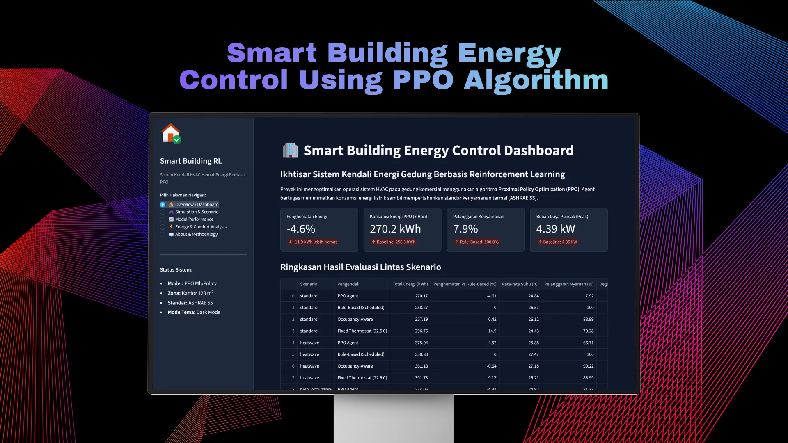


## Project Overview

Smart Building Energy Control Using PPO Algorithm is a reinforcement learning control system designed to optimize commercial building Heating, Ventilation, and Air Conditioning (HVAC) operation. Built on a physics-based 1R1C lumped-capacitance thermal model inside a custom Gymnasium environment, a Proximal Policy Optimization (PPO) agent continuously modulates HVAC temperature setpoints to balance electricity consumption against ASHRAE 55 thermal comfort standards across dynamic weather and occupancy profiles.

## Problem Statement & Objectives

Commercial HVAC systems account for over 40% of total building electricity consumption, yet conventional rule-based schedules and fixed thermostats struggle with building thermal inertia. Scheduled setback controllers deactivate cooling overnight and restart at 08:00, causing severe morning thermal discomfort due to slow wall and air-mass cooling lag, whereas static 24/7 thermostats waste energy conditioning empty zones during off-hours and weekends.

- Model realistic single-zone commercial office thermodynamics (120 m² floor area, 360 m³ volume) using a 1R1C lumped-capacitance heat balance formulation with solar gain, occupancy sensible heat, equipment loads, and temperature-dependent HVAC Coefficient of Performance (COP).
- Implement a Gymnasium-compliant continuous control environment (`SmartBuildingEnv`) with an 8-dimensional normalized observation space and 1-dimensional continuous setpoint action space (`[20.0 °C, 26.0 °C]`).
- Train a PPO Actor-Critic agent using a multi-objective reward function that jointly penalizes electrical power demand, quadratic thermal comfort violations, and abrupt control oscillations.
- Benchmark the trained PPO policy across four multi-seed evaluation scenarios (`standard`, `heatwave`, `high_occupancy`, `weekend`) against three conventional baselines (`Rule-Based (Scheduled)`, `Occupancy-Aware`, and `Fixed Thermostat (22.5 C)`).
- Provide reproducible training/evaluation scripts, publication-grade Matplotlib/Seaborn figures, unit tests, and an interactive dark-mode Streamlit analytics dashboard.

## Data & Input Sources

No standalone static training dataset is used in this project; instead, the RL agent learns through online closed-loop interaction with a physics-driven stochastic simulator (`SmartBuildingEnv` in [building_env.py](src/environment/building_env.py)) powered by analytical weather and occupancy generators ([thermal_model.py](src/environment/thermal_model.py)). Recorded training logs, multi-seed evaluation summaries, and step-by-step simulation trajectories are persisted as CSV, JSON, and NPZ artifacts.

| Dataset / Input Source | Source | Format | Scale / Resolution | Features / Input Shape | Target / Output |
|---|---|---|---|---|---|
| Online Gymnasium Simulation | `src/environment/building_env.py` | Runtime `float32` Tensor | 100,000 steps (~149 7-day episodes @ 15-min dt) | `Box(8,)` normalized state vector | Continuous setpoint action `Box(1,)` (`20.0–26.0 °C`) |
| Weather Generator (`WeatherGenerator`) | `src/environment/thermal_model.py` | Procedural Time Series | 672 steps/episode (4 steps/hr, 7 days) | Diurnal cosine + synoptic wave + Gaussian noise (`T_out`, `I_solar`) | Passive envelope & solar heat gains |
| Occupancy Generator (`OccupancyGenerator`) | `src/environment/thermal_model.py` | Procedural Time Series | 0–25 occupants (weekday/lunch/weekend profiles) | Occupancy count `N_occ` & work-schedule flags | Internal sensible heat & comfort band selection |
| Training & Evaluation Logs | `logs/training_history.csv`, `logs/evaluations.npz`, `metrics/evaluation_summary.csv` | CSV / JSON / NPZ | 149 training episodes; 16 scenario-controller rows | Episode rewards, kWh energy, comfort %, degree-hours, peak kW | Benchmark comparison & trajectory CSVs |

## Data Preprocessing & Feature Engineering

All raw physical state variables from the thermal simulator are transformed in real time inside `SmartBuildingEnv._normalize_obs` and `SmartBuildingEnv.step` so the neural policy receives bounded, scale-invariant inputs and outputs smooth physical setpoints.

| Transformation | Input Signal | Output Representation | Purpose |
|---|---|---|---|
| Linear Min-Max / Center Scaling | Indoor temp `T_in` (`16–30 °C`), Outdoor temp `T_out` (`16–40 °C`) | Clipped `[-1.0, 1.0]` scalars | Stabilizes MLP gradient updates across extreme heatwave conditions |
| Occupancy Normalization | Occupant count `N_occ` (`0–25`) | `clip((N_occ / max_occ) * 2 - 1, -1, 1)` | Maps zero-to-full occupancy symmetrically into `[-1.0, 1.0]` |
| Cyclical Temporal Encoding | Simulation hour `hour` (`0.0–23.75`) | `sin(2π * hour / 24)` and `cos(2π * hour / 24)` | Preserves 24-hour diurnal continuity without midnight discontinuity |
| Schedule Binary Indicators | Day index & work hours (`08:00–18:00`) | `is_workday`, `is_work_hour` in `{-1.0, 1.0}` | Enables policy differentiation between occupied office shifts and off-hours |
| Action-to-Setpoint Affine Mapping | Normalized policy action `a_t` in `[-1.0, 1.0]` | `T_set = 23.0 + a_t * 3.0` (`[20.0, 26.0] °C`) | Converts bounded Gaussian policy outputs into physical thermostat setpoints |

1. Convert the discrete 15-minute simulation step index into `day_index`, `hour`, `is_workday`, and `is_work_hour` via `_get_time_features`.
2. Sample outdoor temperature, solar irradiance, and occupant count from `WeatherGenerator` and `OccupancyGenerator` synchronized to `self.np_random`.
3. Normalize thermal, occupancy, temporal, and previous-setpoint signals into an 8-element `np.float32` observation vector bounded within `[-1.0, 1.0]`.
4. Clip the agent's continuous action to `[-1.0, 1.0]` and map it linearly to the HVAC cooling setpoint before advancing the 1R1C thermodynamic integration step.

## Tech Stack

| Category | Technology | Purpose |
|---|---|---|
| Programming Language | Python | Core simulation physics, RL pipeline, evaluation, and dashboard |
| Reinforcement Learning | Stable-Baselines3 | PPO algorithm implementation, rollout buffer, and `EvalCallback` |
| Deep Learning Backend | PyTorch | Actor-Critic MLP neural networks (`MlpPolicy`) and Adam optimization |
| Simulation Interface | Gymnasium | Standardized continuous `Env` API, spaces, and `check_env` validation |
| Numerical Computing | NumPy | Thermodynamic differential integration, RNG seeding, and array math |
| Data Processing | Pandas | Trajectory logging, multi-seed aggregation, and CSV metric export |
| Configuration Management | PyYAML | Centralized thermal, HVAC, reward, and RL hyperparameters in YAML |
| Visualization | Matplotlib, Seaborn | 300 DPI comparative plots, reward curves, and Pareto trade-off charts |
| Interactive Dashboard | Streamlit | Dark-mode 5-page interactive analytics and scenario exploration UI |
| Automated Testing | Pytest | Unit tests for thermal physics, generators, and Gymnasium compliance |

## Machine Learning Approach

This project formulates building HVAC control as a continuous-state, continuous-action Markov Decision Process (MDP) solved via model-free on-policy **Reinforcement Learning**. Unlike supervised forecasting or fixed-rule heuristics, the PPO agent learns a closed-loop control policy directly from multi-objective reward feedback that captures thermal inertia lag, time-varying solar and internal heat loads, and temperature-dependent chiller efficiency.

| Attribute | Value |
|---|---|
| Learning Paradigm | Reinforcement Learning |
| Problem Domain | Smart Building HVAC Energy & Thermal Comfort Optimization |
| ML Task | Continuous Setpoint Control (Sequential Decision-Making) |
| Input Representation | 8-dimensional continuous normalized observation vector `Box(8,)` |
| Target / Action Output | 1-dimensional continuous HVAC setpoint modulation `Box(1,)` mapped to `20.0–26.0 °C` |
| Reward Formulation | `R_t = -(w_energy * P_kw / 5.0) - (w_comfort * occ_weight * ΔT²) - (w_stability * Δa²)` |

## Model Overview

The primary control policy is a Proximal Policy Optimization (PPO) Actor-Critic neural network (`MlpPolicy`) trained from scratch in `SmartBuildingEnv` using Stable-Baselines3 ([train_ppo.py](src/agents/train_ppo.py)). Its performance is benchmarked against three deterministic rule-based and static thermostat controllers implemented in [rule_based.py](src/baselines/rule_based.py).

| Attribute | Specification |
|---|---|
| Primary Model | Proximal Policy Optimization (`PPO Agent`) |
| Architecture | Dual-head Actor-Critic MLP (`pi=[128, 128]`, `vf=[128, 128]`, `Tanh` activation) |
| Framework | Stable-Baselines3 with PyTorch backend |
| Pretrained Status | Trained from scratch (100,000 timesteps / 149 7-day episodes on CPU) |
| Action Distribution | Continuous diagonal Gaussian policy (deterministic mean used at evaluation) |
| Comparison Baselines | `Rule-Based (Scheduled)`, `Occupancy-Aware`, `Fixed Thermostat (22.5 C)` |

## ML Workflow

1. **Configuration & Seeding**: Load physical building constants, comfort bounds, reward weights, and PPO hyperparameters from [config/experiment_config.yaml](config/experiment_config.yaml), and synchronize Python, NumPy, and PyTorch random seeds.
2. **Environment Construction & Verification**: Instantiate `SmartBuildingEnv` ([src/environment/building_env.py](src/environment/building_env.py)) backed by the 1R1C `BuildingThermalModel` ([src/environment/thermal_model.py](src/environment/thermal_model.py)) and validate API compliance with `tests/test_environment.py`.
3. **PPO Policy Training**: Wrap training and evaluation environments in `DummyVecEnv`, attach `TrainingMetricsCallback` and `EvalCallback` (`eval_freq=5000`), and execute `model.learn(total_timesteps=100000)` in [src/agents/train_ppo.py](src/agents/train_ppo.py).
4. **Checkpoint & Log Persistence**: Save the best evaluation checkpoint (`models/best_model/ppo_smart_building.zip`), final model (`models/checkpoints/ppo_final.zip`), episode history (`logs/training_history.csv`), and run metadata (`logs/experiment_metadata.json`).
5. **Multi-Scenario, Multi-Seed Evaluation**: Run deterministic rollouts across four scenarios (`standard`, `heatwave`, `high_occupancy`, `weekend`) and three seeds (`42, 101, 2024`) comparing PPO against all three baseline controllers in [src/evaluation/evaluate.py](src/evaluation/evaluate.py).
6. **Visualization & Interactive Exploration**: Generate 10 high-resolution figures in `figures/` via [src/visualization/create_figures.py](src/visualization/create_figures.py) and launch the dark-mode analytics dashboard via [streamlit/streamlit_app.py](streamlit/streamlit_app.py). Detailed engineering findings are documented in [final_report.md](final_report.md).

## ML Pipeline Architecture

The end-to-end pipeline separates thermodynamic simulation, on-policy PPO optimization, multi-seed comparative benchmarking, and visual reporting into modular Python components linked through shared YAML configuration and persisted artifacts.

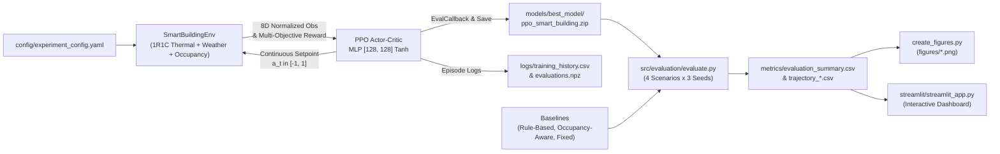

## Model Training & Configuration

The PPO agent is trained from scratch for 100,000 timesteps (149 complete 7-day episodes of 672 steps each) on the `standard` scenario using seed `42`, completing in 104.32 seconds (1.74 minutes) on CPU (`torch==2.15.0+cpu`, Python `3.15.1`). Periodic evaluation runs every 5,000 timesteps across 3 deterministic episodes to select the best checkpoint.

| Parameter | Configured Value | Description |
|---|---|---|
| Total Timesteps | `100,000` | Total environment steps (~149 7-day episodes) |
| Rollout Horizon (`n_steps`) | `2,048` | Steps collected per policy update (>3 simulated days) |
| Minibatch Size (`batch_size`) | `64` | Minibatch size for clipped surrogate gradient updates |
| Optimization Epochs (`n_epochs`) | `10` | Number of passes over each rollout buffer |
| Learning Rate (`learning_rate`) | `0.0003` | Adam optimizer step size |
| Discount Factor (`gamma`) | `0.99` | Long-horizon cumulative reward discount |
| GAE Lambda (`gae_lambda`) | `0.95` | Generalized Advantage Estimation smoothing factor |
| Clip Range (`clip_range`) | `0.2` | PPO surrogate policy ratio clipping epsilon |
| Entropy Coefficient (`ent_coef`) | `0.005` | Exploration regularization weight |
| Value Loss Coefficient (`vf_coef`) | `0.5` | Critic MSE loss weight |
| Max Gradient Norm (`max_grad_norm`) | `0.5` | Global gradient norm clipping threshold |
| Policy Network (`net_arch`) | `pi=[128, 128], vf=[128, 128]` (`Tanh`) | Separate 2-layer Actor and Critic MLPs |
| Reward Weights | `w_e=1.0`, `w_c=3.5`, `w_s=0.2` | Energy, quadratic comfort (`p=2.0`), and action-delta penalties |

```bash
python src/agents/train_ppo.py --config config/experiment_config.yaml --timesteps 100000 --seed 42
```

## Model Comparison & Selection

All four controllers are evaluated across four independent scenarios (`standard`, `heatwave`, `high_occupancy`, `weekend`) averaged over 3 random seeds (`[42, 101, 2024]`) from `metrics/evaluation_summary.csv`. Although `Rule-Based (Scheduled)` consumes slightly fewer kWh than PPO, it violates ASHRAE 55 comfort bounds 100% of occupied time during weekdays (mean indoor temperature 26.57 °C in `standard`), whereas `PPO Agent` eliminates 99.2% of comfort degree-hours while saving 8.96% energy compared to the `Fixed Thermostat (22.5 C)` controller that maintains cooling.

| Scenario | Controller | Total Energy (kWh) | Avg Indoor Temp (°C) | Comfort Violation (%) | Degree-Hours (°C·h) | Peak Power (kW) | Total Reward |
|---|---|---|---|---|---|---|---|
| `standard` | **PPO Agent** | **270.17** | **24.84** | **7.92%** | **0.92** | 4.39 | **-221.81** |
| `standard` | Rule-Based (Scheduled) | 258.27 | 26.57 | 100.00% | 115.99 | 4.35 | -3581.54 |
| `standard` | Occupancy-Aware | 257.19 | 26.12 | 88.99% | 91.66 | 4.34 | -2854.65 |
| `standard` | Fixed Thermostat (22.5 C) | 296.76 | 24.43 | 79.28% | 77.39 | 4.34 | -2174.52 |
| `heatwave` | **PPO Agent** | **375.04** | **25.88** | **66.71%** | **74.21** | 4.93 | **-2669.30** |
| `heatwave` | Rule-Based (Scheduled) | 358.83 | 27.47 | 100.00% | 215.78 | 4.93 | -11508.01 |
| `heatwave` | Occupancy-Aware | 361.13 | 27.18 | 99.22% | 184.71 | 4.93 | -9643.76 |
| `heatwave` | Fixed Thermostat (22.5 C) | 391.73 | 25.21 | 88.99% | 160.58 | 4.93 | -8065.95 |
| `high_occupancy` | **PPO Agent** | **274.05** | **24.92** | **21.37%** | **4.56** | 4.39 | **-249.92** |
| `high_occupancy` | Rule-Based (Scheduled) | 262.57 | 26.61 | 100.00% | 122.53 | 4.39 | -3931.44 |
| `high_occupancy` | Occupancy-Aware | 261.44 | 26.17 | 89.25% | 97.65 | 4.39 | -3162.39 |
| `high_occupancy` | Fixed Thermostat (22.5 C) | 301.07 | 24.47 | 79.79% | 83.16 | 4.39 | -2466.10 |
| `weekend` | **PPO Agent** | **225.97** | **24.25** | **0.00%** | **0.00** | 3.84 | **-184.19** |
| `weekend` | Rule-Based (Scheduled) | 208.63 | 26.15 | 90.78% | 68.68 | 3.58 | -2389.21 |
| `weekend` | Occupancy-Aware | 206.11 | 26.76 | 100.00% | 148.15 | 4.36 | -5827.20 |
| `weekend` | Fixed Thermostat (22.5 C) | 250.20 | 24.08 | 71.04% | 34.63 | 3.53 | -684.67 |

## Model Artifacts & Checkpoints

All trained policy checkpoints, rollout logs, and evaluation records are stored locally inside the repository.

| Artifact Name | Format | Purpose | Location |
|---|---|---|---|
| `ppo_smart_building.zip` | Stable-Baselines3 ZIP | Best-performing PPO policy checkpoint selected via `EvalCallback` | [models/best_model/ppo_smart_building.zip](models/best_model/ppo_smart_building.zip) |
| `best_model.zip` | Stable-Baselines3 ZIP | Raw `EvalCallback` best model archive (peak eval reward `-224.03 ± 2.98`) | [models/best_model/best_model.zip](models/best_model/best_model.zip) |
| `ppo_final.zip` | Stable-Baselines3 ZIP | Final policy weights saved at 100,000 training timesteps | [models/checkpoints/ppo_final.zip](models/checkpoints/ppo_final.zip) |
| `training_history.csv` | CSV | Per-episode reward and 20-episode moving average across 149 episodes | [logs/training_history.csv](logs/training_history.csv) |
| `evaluations.npz` | NumPy NPZ | Deterministic evaluation scores recorded every 5,000 steps | [logs/evaluations.npz](logs/evaluations.npz) |
| `experiment_metadata.json` | JSON | Runtime Python/PyTorch versions, duration, seed, and final reward | [logs/experiment_metadata.json](logs/experiment_metadata.json) |

## Model Evaluation & Results

Training convergence and held-out multi-seed evaluation confirm that the PPO agent learns an anticipatory pre-cooling policy without requiring explicit manual rules. On the `standard` training distribution, 20-episode running reward improves from `-6,281.46` (Episode 1) to `-234.29` (Episode 149), while deterministic `EvalCallback` reward peaks at `-224.03 ± 2.98` at step 95,000. On held-out evaluation seeds (`[42, 101, 2024]`), PPO achieves balanced energy-comfort Pareto dominance across all four scenarios.

| Evaluation Metric | PPO Agent (`standard`) | PPO Agent (`weekend`) | Comparison Benchmark |
|---|---|---|---|
| Comfort Violation Rate | `7.92%` | `0.00%` | `100.00%` (Rule-Based `standard`) |
| Comfort Deviation (Degree-Hours) | `0.92 °C·h` | `0.00 °C·h` | `115.99 °C·h` (Rule-Based `standard`) |
| 7-Day Energy Consumption | `270.17 ± 1.00 kWh` | `225.97 ± 0.60 kWh` | `296.76 ± 0.86 kWh` (Fixed Thermostat `standard`) |
| Energy Saving vs Fixed Thermostat | `8.96%` (`26.59 kWh` saved) | `9.68%` (`24.23 kWh` saved) | `0.00%` (24/7 Fixed `22.5 °C` baseline) |
| Mean Episode Return | `-221.81` | `-184.19` | `-3581.54` (Rule-Based `standard`) |
| Peak Electrical Demand | `4.39 kW` | `3.84 kW` | `4.35 kW` (Rule-Based `standard`) |

- **Pre-Cooling Adaptation**: PPO lowers the setpoint prior to the 08:00 occupancy arrival, eliminating morning thermal inertia lag while keeping occupied indoor temperature around `24.84 °C`.
- **Extreme Heatwave Stress Test**: Under `heatwave` conditions (`28–38.5 °C` outdoor), cooling capacity saturation (`12 kW` max) raises PPO comfort violation to `66.71%` (`74.21 °C·h`), still outperforming Rule-Based (`100.0%`, `215.78 °C·h`) and Fixed Thermostat (`88.99%`, `160.58 °C·h`).
- **Known Limitations**: The simulator uses a single-zone 1R1C lumped approximation, analytical synthetic weather rather than EnergyPlus EPW files, and omits indoor humidity and CO₂ ventilation dynamics.

## Results Visualization & Preview

### 1. Streamlit Overview & Cross-Scenario KPI Dashboard
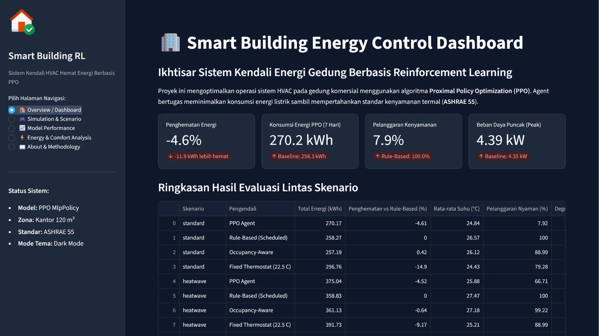
The primary overview screen of the dark-mode Streamlit dashboard summarizes 7-day PPO performance (`270.2 kWh` total energy, `7.9%` comfort violation vs `100.0%` Rule-Based, and `4.39 kW` peak load) alongside the multi-scenario benchmark table. It highlights why PPO's slight energy difference versus the under-cooling Rule-Based schedule (`-4.6%`) reflects active satisfaction of ASHRAE 55 thermal limits.

### 2. Interactive Simulation & Scenario Trajectory Explorer
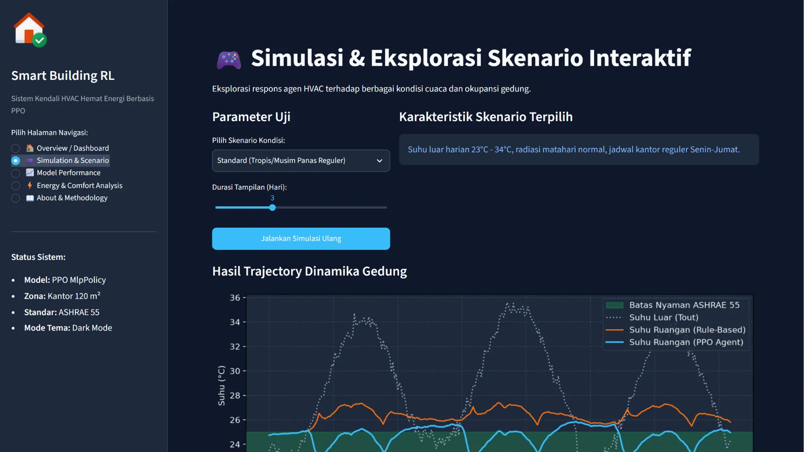
This interactive simulator view enables scenario switching (`standard`, `heatwave`, `high_occupancy`, `weekend`) and horizon selection to inspect closed-loop building trajectories. Over the displayed 3-day window, the PPO trajectory remains tightly anchored inside the shaded ASHRAE 55 comfort band (`22–25 °C`) while the Rule-Based controller drifts above `26–27 °C`.

### 3. PPO Training Convergence & Episode Metadata
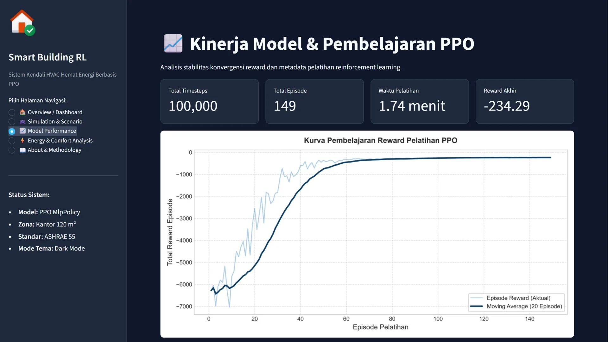
The model performance panel pairs training telemetry (`100,000` timesteps, `149` episodes, `1.74` minutes CPU runtime, `-234.29` final running reward) with the full training reward curve. Episode return climbs smoothly from `-6,281` to a stable plateau near `-234` by episode 80 without policy collapse.

### 4. Multi-Chart Energy & Thermal Comfort Analytics Grid
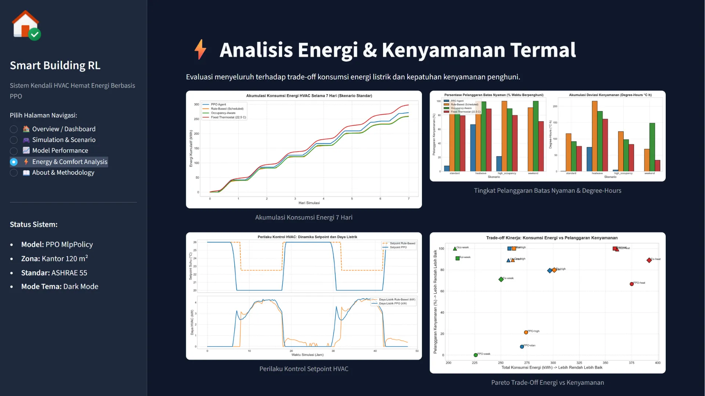
This four-panel analytical dashboard consolidates 7-day cumulative energy curves, comfort violation and degree-hour bar charts, HVAC setpoint/power dynamics, and the Pareto energy-versus-comfort scatter plot. Together, the charts illustrate PPO occupying the bottom-left Pareto frontier across all operating regimes.

### 5. Thermodynamic 1R1C & Reward Formulation Reference View
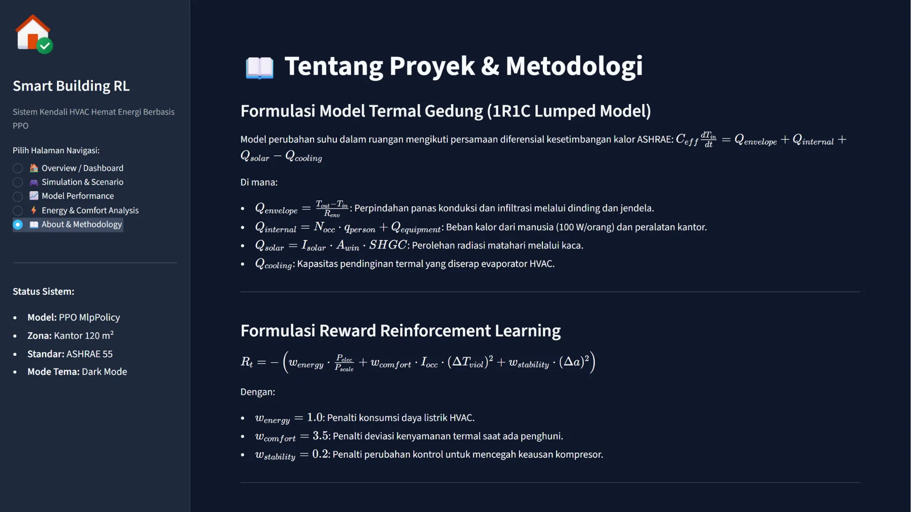
The methodology page documents the governing 1R1C heat-balance differential equation (`Q_envelope`, `Q_internal`, `Q_solar`, `Q_cooling`) and the three-term RL reward equation with exact configured penalty weights (`w_energy = 1.0`, `w_comfort = 3.5`, `w_stability = 0.2`).

### 6. Training Curve, 7-Day Energy Totals & Pareto Frontier Grid
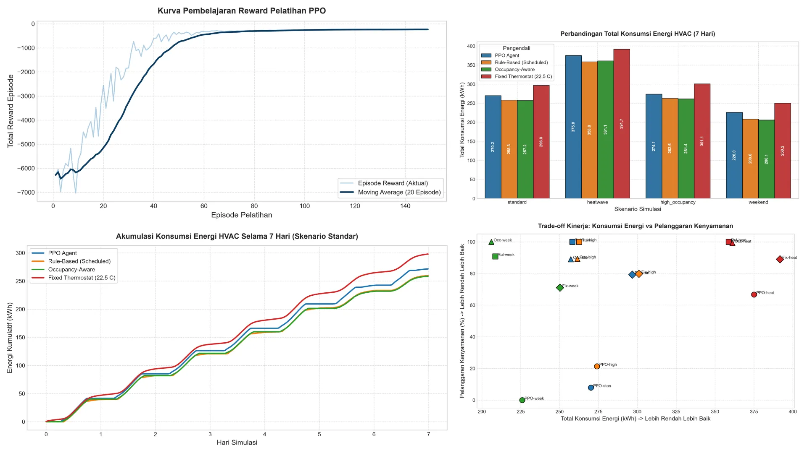
This four-panel static figure grid compares PPO training convergence (top-left), 7-day energy consumption across all four scenarios (top-right), cumulative standard-week kWh trajectories (bottom-left), and the energy-versus-violation Pareto scatter plot (bottom-right). PPO consistently uses less electricity than Fixed Thermostat (`270.2` vs `296.8 kWh` in `standard`) while cutting comfort violations below `8%` on standard workweeks.

### 7. Indoor Temperature Profile: PPO vs Rule-Based (First 3 Days)
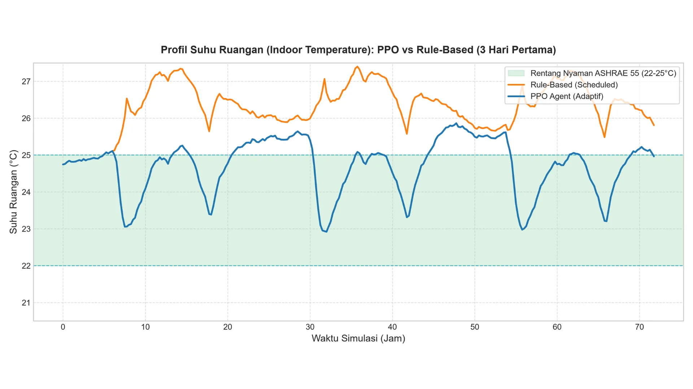
Over the first 72 hours of the `standard` scenario, the Rule-Based controller (orange) repeatedly spikes to `26.5–27.3 °C` during working hours due to thermal mass lag when cooling restarts at 08:00. In contrast, the PPO agent (blue) initiates pre-cooling prior to arrival and sustains indoor temperatures within the green `22–25 °C` ASHRAE 55 comfort corridor.

### 8. Diurnal Outdoor Temperature vs PPO-Controlled Indoor Response
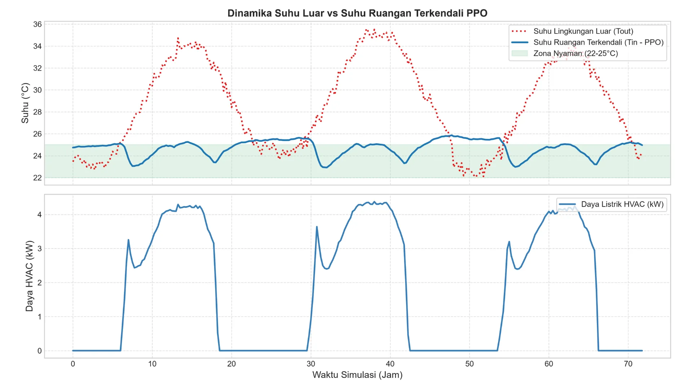
This dual-axis time series pairs outdoor diurnal temperature swings (`22–35.5 °C`) against PPO-stabilized indoor temperature (top) and corresponding HVAC electrical load in kW (bottom). The agent absorbs daytime solar and envelope heat spikes by ramping chiller power up to `4.39 kW` while shutting off overnight when the zone remains within unoccupied bounds.

### 9. HVAC Setpoint Modulation & Power Draw Dynamics
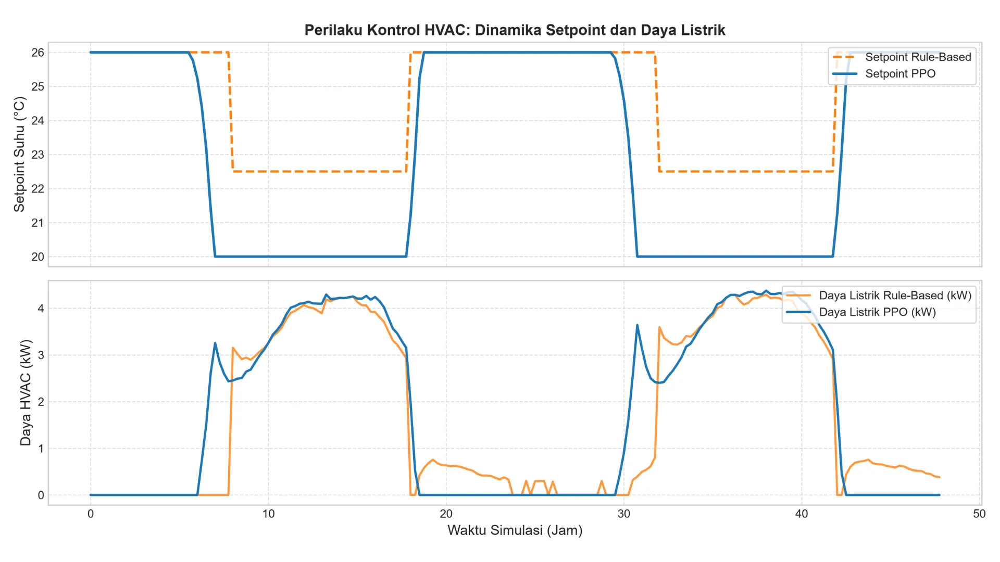
Comparing setpoint trajectories over 48 hours reveals that PPO shifts setpoints smoothly ahead of morning occupancy (`26.0 °C` down to `20.0 °C`) rather than relying on delayed `08:00` step drops (`22.5 °C`). As a result, afternoon chiller demand tracks peak cooling load cleanly without late-evening rebound cycling seen in the Rule-Based trace.

### 10. Seven-Day Commercial Office Occupancy Profile
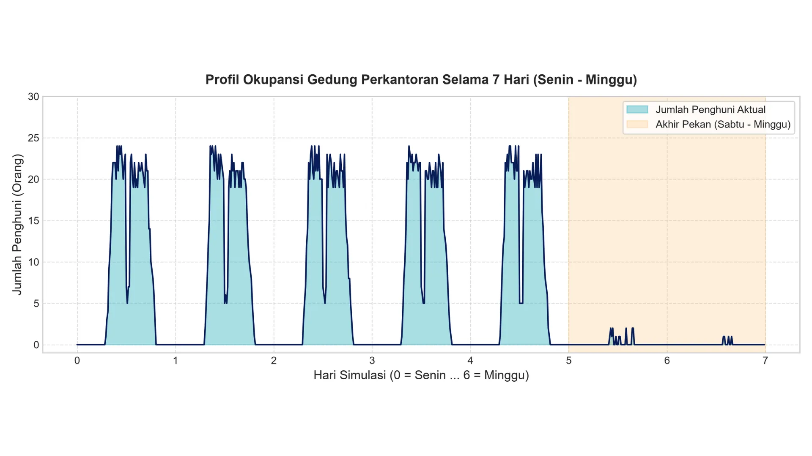
This profile verifies the stochastic commercial building occupancy schedule across Monday through Sunday, peaking at `20–24` occupants during core office hours (`08:30–17:00`), dipping to ~5 occupants during the `12:00–13:00` lunch break, and dropping to `0–2` occasional staff on weekends.

### 11. Reward Function Component Decomposition Over Time
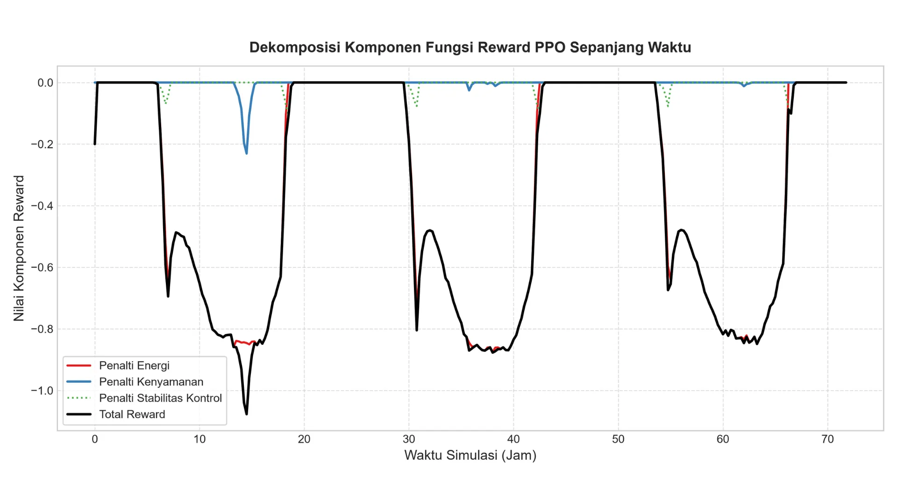
Decomposing total step reward into energy, comfort, and control-stability penalties over 72 hours shows that thermal comfort penalties remain near `0.0` except for a brief initial transient on day 1. Subsequent total reward magnitude (`-0.5` to `-0.9` during peak afternoon cooling) is governed almost entirely by proportional electricity cost, confirming policy convergence inside the comfort zone.

### 12. Multi-Scenario Comfort Violation & Degree-Hours Comparison
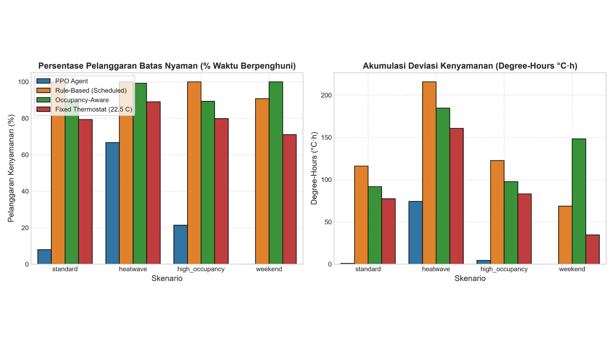
Side-by-side bar charts quantify comfort violation percentages (left) and cumulative degree-hours in `°C·h` (right) across `standard`, `heatwave`, `high_occupancy`, and `weekend` scenarios. PPO reduces standard-scenario degree-hours by `99.2%` (`0.92 °C·h` vs `115.99 °C·h` Rule-Based) and achieves `0.00%` violation (`0.00 °C·h`) throughout the weekend test.

## Prerequisites

- **Operating System**: Windows, Linux, or macOS (verified on Windows 11)
- **Python**: Python 3.10+ (trained and verified on Python `3.15.1`)
- **Core Libraries** (from [requirements.txt](requirements.txt)): `gymnasium>=1.0.0`, `stable-baselines3>=2.3.0`, `torch>=2.0.0`, `numpy>=1.24.0`, `pandas>=2.0.0`, `matplotlib>=3.8.0`, `seaborn>=0.13.0`, `pyyaml>=6.0`, `pytest>=7.0.0`, `streamlit>=1.30.0`, plus `tabulate` (imported in `src/evaluation/evaluate.py`)
- **Compute Hardware**: Standard multi-core CPU (training 100,000 PPO steps completes in ~1.74 minutes without requiring a GPU)

## Installation & Setup

1. Clone the repository and enter the project directory:
   ```bash
   git clone https://github.com/weztcy/Smart-Building-Energy-Control-Using-PPO-Algorithm.git
   cd "Smart Building Energy Control Using PPO Algorithm"
   ```
2. Create and activate a Python virtual environment:
   ```bash
   python -m venv .venv
   # Windows PowerShell:
   .venv\Scripts\Activate.ps1
   # Linux/macOS:
   source .venv/bin/activate
   ```
3. Install required dependencies:
   ```bash
   pip install -r requirements.txt
   pip install tabulate
   ```
4. Verify the thermal physics model and Gymnasium environment compliance:
   ```bash
   python -m pytest -v tests/
   ```

## Usage & Execution

Once dependencies are installed, you can run evaluation on the included trained checkpoint, regenerate figures, or launch the interactive Streamlit dashboard.

1. **Run Multi-Scenario Evaluation** (benchmarks `models/best_model/ppo_smart_building.zip` against all baselines):
   ```bash
   python src/evaluation/evaluate.py --config config/experiment_config.yaml
   ```
2. **Generate High-Resolution Visualization Figures** (reads logs and trajectories to export 10 PNG plots):
   ```bash
   python src/visualization/create_figures.py --config config/experiment_config.yaml
   ```
3. **Launch the Interactive Streamlit Dashboard**:
   ```bash
   python -m streamlit run streamlit/streamlit_app.py --server.port 8501
   ```

## Reproducibility & Execution

All experiments are deterministic up to PyTorch CPU floating-point execution using explicit seeds configured in [config/experiment_config.yaml](config/experiment_config.yaml) (`seed: 42` for training, `eval_seeds: [42, 101, 2024]` for evaluation). Note that `config/experiment_config.yaml` defaults output paths to `outputs/*`, whereas committed repository outputs reside in root `logs/`, `metrics/`, and `figures/`; pass or align config paths if writing fresh outputs into those root folders.

1. Run unit tests to confirm environment determinism and space bounds:
   ```bash
   python -m pytest -v tests/test_environment.py
   ```
2. Retrain the PPO agent from scratch for 100,000 timesteps with seed `42`:
   ```bash
   python src/agents/train_ppo.py --config config/experiment_config.yaml --timesteps 100000 --seed 42
   ```
3. Re-run 3-seed evaluation across all four scenarios (`standard`, `heatwave`, `high_occupancy`, `weekend`):
   ```bash
   python src/evaluation/evaluate.py --config config/experiment_config.yaml --model models/best_model/ppo_smart_building.zip
   ```
4. Regenerate all 10 evaluation plots:
   ```bash
   python src/visualization/create_figures.py --config config/experiment_config.yaml
   ```

## Contributing

Contributions to extend the thermal environment, add multi-zone dynamics, or benchmark additional continuous RL algorithms (such as SAC or TD3) are welcome. Please follow these steps when submitting changes:

1. Fork the repository.
2. Create a feature or fix branch for your change.
3. Make the changes while preserving existing configuration compatibility.
4. Run relevant checks (`python -m pytest -v tests/`) to verify environment integrity.
5. Commit and push the branch to your fork.
6. Open a pull request with a clear explanation of the modification and evaluation impact.

## License

This project is licensed under the MIT License.
See the [LICENSE](LICENSE) file for details.

## Author & Contact

**Yohanes Dimas Pratama**

- GitHub: [github.com/weztcy](https://github.com/weztcy)
- Portfolio: [yohanesdimas.com](https://yohanesdimas.com)
- LinkedIn: [linkedin.com/in/yohanes-dimas](https://www.linkedin.com/in/yohanes-dimas)
