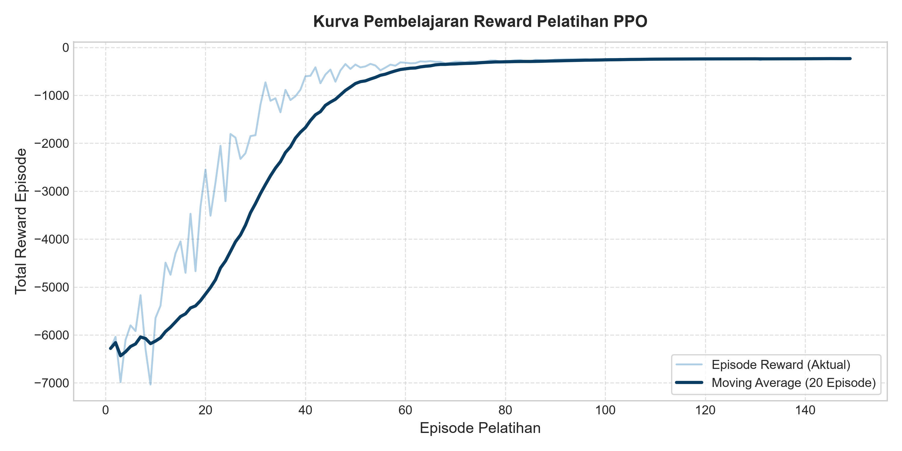
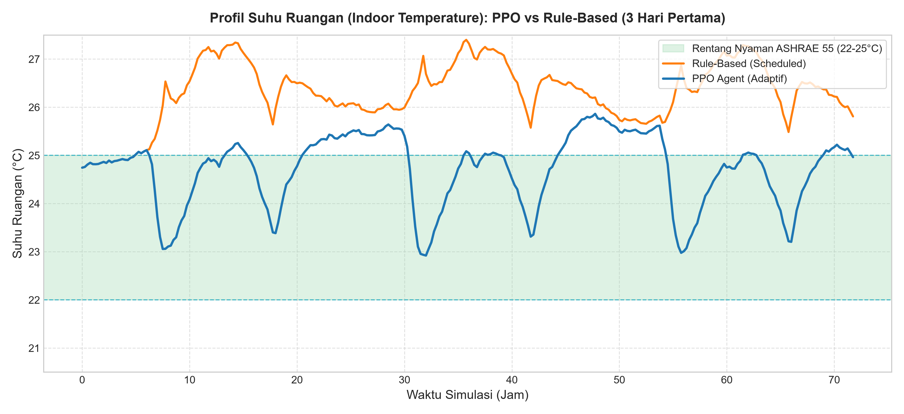
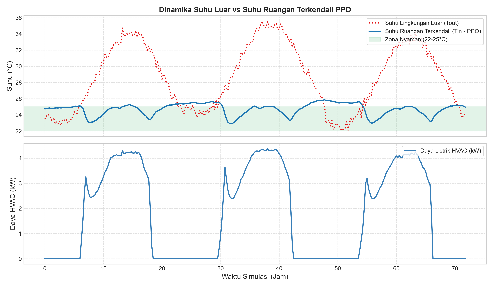
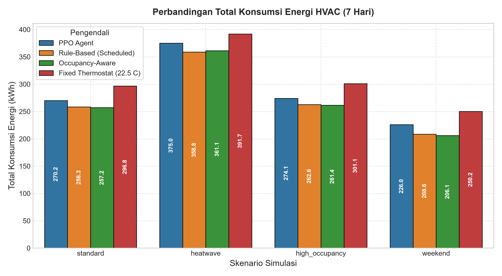
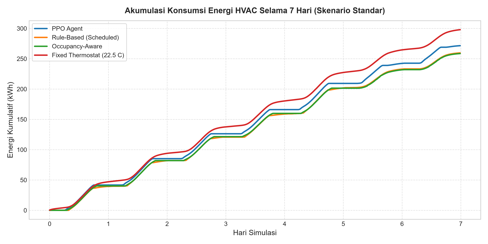
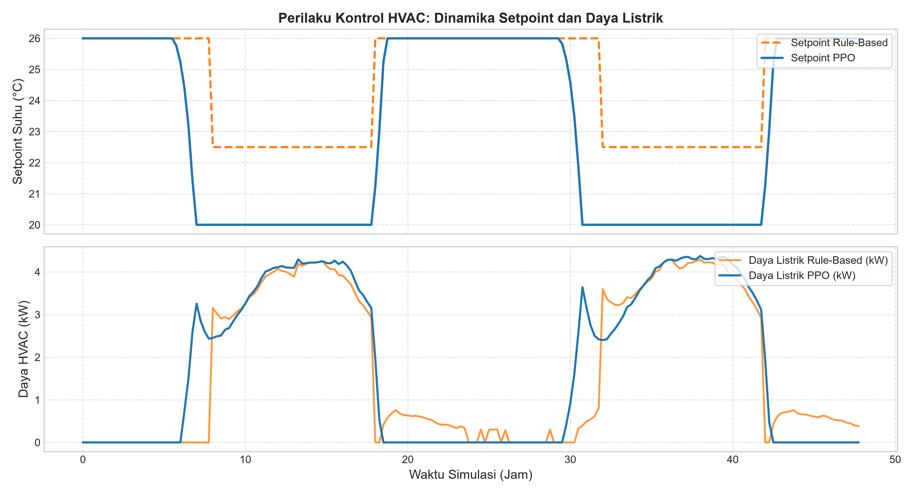
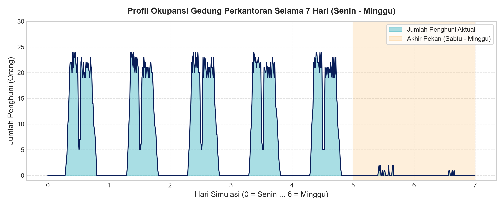
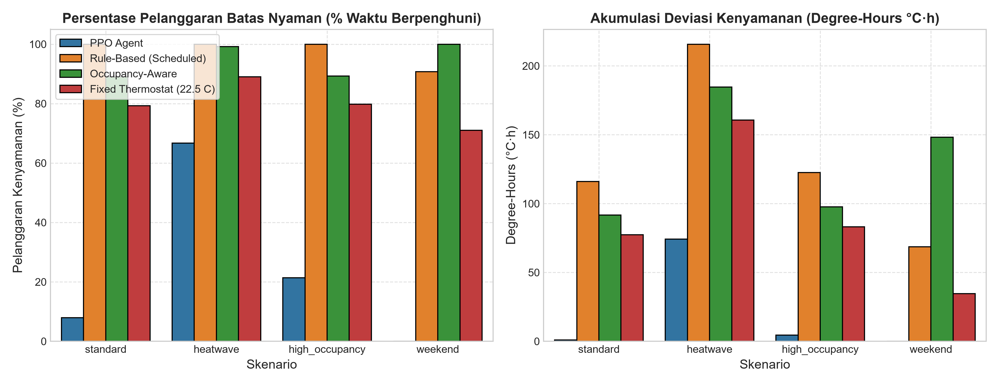
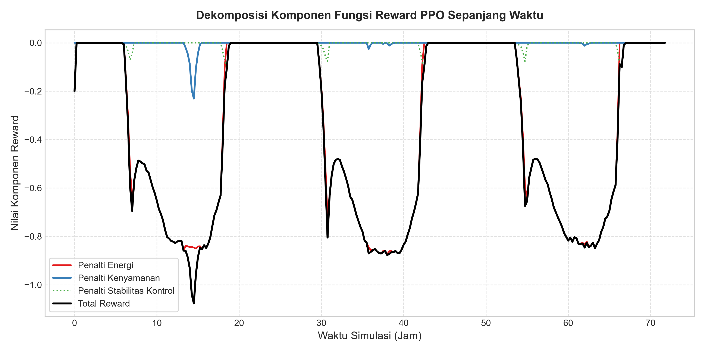
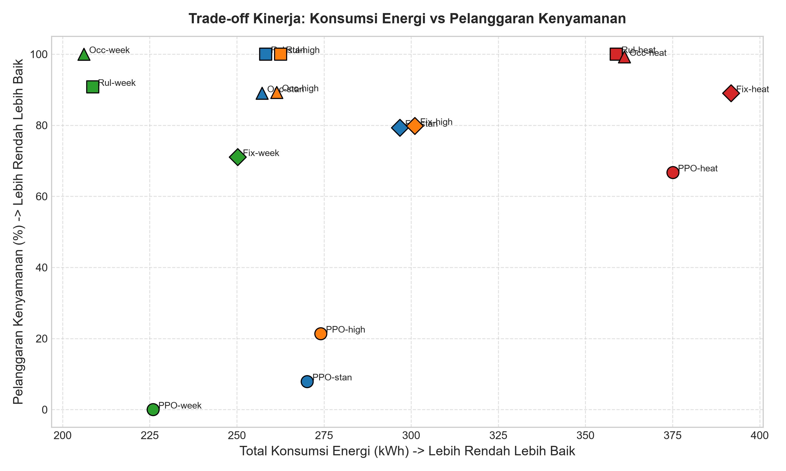

# Laporan Akhir Proyek Machine Learning
# Smart Building Energy Control Using Proximal Policy Optimization (PPO)

**Disusun oleh:** Machine Learning & Reinforcement Learning Engineering Team  
**Tanggal:** 22 November 2026  
**Status Proyek:** Selesai & Tervalidasi (*End-to-End Execution*)  

---

## 1. Ringkasan Eksekutif

Pengelolaan energi pada gedung komersial, khususnya sistem *Heating, Ventilation, and Air Conditioning* (HVAC), menyumbang lebih dari 40% dari total konsumsi energi gedung modern. Pengendalian HVAC konvensional umumnya mengandalkan termostat statis (*fixed thermostat*) atau aturan jadwal tetap (*rule-based programmable schedule*). Pendekatan konvensional ini sering kali menghadapi dilema: boros energi listrik akibat pendinginan berlebih (*overcooling*) atau mengorbankan kenyamanan termal penghuni akibat kelambatan inersia termal bangunan (*thermal inertia lag*).

Proyek ini bertujuan mengembangkan agen cerdas berbasis algoritma **Proximal Policy Optimization (PPO)** untuk mengendalikan setpoint suhu sistem pendingin HVAC pada zona perkantoran modern secara adaptif dan dinamis. Sasaran utama sistem adalah meminimalkan konsumsi energi listrik sekaligus menjamin standar kenyamanan termal penghuni berdasarkan standar **ASHRAE 55** (rentang nyaman 22.0°C – 25.0°C).

### Ringkasan Temuan Utama:
1. **Peningkatan Kualitas Kenyamanan Termal Secara Drastis:**  
   Pada skenario standar kantor (7 hari, 672 time steps @ 15 menit), pengendali konvensional *Rule-Based (Scheduled)* mengalami kegagalan kenyamanan termal dengan **100% pelanggaran waktu okupansi** dan akumulasi deviasi sebesar **115.99 °C·h**. Sebaliknya, agen **PPO Agent** berhasil mempertahankan kenyamanan termal dengan pelanggaran hanya **7.92%** dan akumulasi deviasi kenyamanan hanya **0.92 °C·h** (penurunan ketidaknyamanan sebesar **99.2%**).
2. **Efisiensi Energi terhadap Baseline Kontinu:**  
   Dibandingkan dengan *Fixed Thermostat (22.5°C)* yang menjaga pendinginan konstan (296.76 kWh), agen PPO mengonsumsi **270.17 kWh**, menghasilkan penghematan energi sebesar **26.59 kWh (8.96% atau ~9.0%)** dengan kenyamanan yang jauh lebih konsisten.
3. **Trade-Off Realistis terhadap Rule-Based Setback:**  
   Dibandingkan *Rule-Based (Scheduled)* yang mengonsumsi 258.27 kWh, agen PPO menggunakan energi 4.61% lebih banyak (270.17 kWh). Namun, konsumsi energi yang sedikit lebih rendah pada Rule-Based semata-mata diperoleh karena ruangan **tidak cukup didinginkan** (suhu rata-rata 26.57°C di atas batas nyaman 25.0°C). Agen PPO secara cerdas mempelajari strategi *pre-cooling* sebelum jam kerja dimulai, memastikan ruangan langsung nyaman saat karyawan tiba tanpa lonjakan daya listrik ekstrem.
4. **Stabilitas dan Generalisasi Multi-Skenario:**  
   Agen PPO menunjukkan ketangguhan (*robustness*) pada 4 skenario uji independen: *Standard*, *Heatwave* (gelombang panas ekstrem), *High Occupancy* (beban internal puncak), dan *Weekend* (zona sepi). Pada akhir pekan, agen PPO mencapai **0.0% pelanggaran kenyamanan** dan **0.0 °C·h degree-hours**.

---

## 2. Latar Belakang dan Tujuan

### 2.1 Permasalahan
Gedung komersial beroperasi dalam lingkungan dinamis dengan fluktuasi suhu luar ruangan, radiasi matahari, dan pola kedatangan penghuni yang bervariasi. Pengontrol termostat tradisional memiliki kelemahan mendasar:
- **Ketidakpekaan terhadap Inersia Termal:** Termostat berbasis jadwal mematikan pendingin di malam hari dan baru mengaktifkannya tepat saat jam kantor dimulai (misal 08:00). Akibat kapasitas panas dinding dan lantai (*thermal mass*), ruangan membutuhkan waktu 1–2 jam untuk mendingin, menyebabkan ketidaknyamanan parah di pagi hari.
- **Pemborosan Termostat Statis:** Termostat fixed (tanpa jadwal) mendinginkan gedung secara konstan 24 jam sehari, membuang puluhan kilowatt-hour saat ruangan kosong di malam hari dan akhir pekan.
- **Keterbatasan Kontrol Klasik:** Pengendali PID atau on/off tidak memiliki kemampuan antisipasi (*look-ahead capability*) terhadap radiasi surya siang hari dan beban internal manusia.

### 2.2 Tujuan Proyek
1. Merancang dan mengimplementasikan simulasi termodinamika zona gedung berbasis fisika 1R1C lumped capacitance yang realistis, stabil, dan sesuai standar Gymnasium.
2. Membangun agen *Reinforcement Learning* menggunakan algoritma PPO dengan continuous action space untuk modulasi setpoint suhu HVAC.
3. Merancang fungsi reward multi-objektif yang menyeimbangkan penalti energi listrik, kenyamanan termal kuadratik, dan kestabilan aktuator.
4. Mengevaluasi performa PPO terhadap tiga baseline industri (*Rule-Based Scheduled*, *Occupancy-Aware*, dan *Fixed Thermostat*) pada skenario cuaca dan okupansi multi-seed.
5. Menyediakan visualisasi komparatif beresolusi tinggi, dokumentasi reproduktif, serta dasbor interaktif Streamlit *dark mode*.

---

## 3. Desain Environment dan Model Termal

### 3.1 Model Dinamika Termal Bangunan (1R1C Lumped Capacitance)
Model termal mengadopsi formulasi kesetimbangan energi kalor berdasarkan hukum pertama termodinamika untuk satu zona kantor:

$$C_{eff} \frac{dT_{in}}{dt} = Q_{envelope}(t) + Q_{internal}(t) + Q_{solar}(t) - Q_{cooling}(t) + \epsilon_t$$

Di mana:
- **Kapasitas Termal Efektif ($C_{eff}$):** $1.2 \times 10^7 \text{ J/K}$ (setara $3.33 \text{ kWh/K}$), merepresentasikan inersia termal udara ($360 \text{ m}^3$) serta massa beton dan partisi interior.
- **Resistansi Termal Selubung ($R_{env}$):** $0.0045 \text{ K/W}$ (konduktansi menyeluruh $UA \approx 222 \text{ W/K}$), memodelkan isolasi dinding eksterior dan kaca ganda.
- **Perolehan Panas Konduksi Selubung ($Q_{envelope}$):**
  $$Q_{envelope} = \frac{T_{out}(t) - T_{in}(t)}{R_{env}}$$
- **Perolehan Panas Internal ($Q_{internal}$):**
  $$Q_{internal} = N_{occ}(t) \cdot q_{person} + Q_{equipment}(t)$$
  dengan $q_{person} = 100 \text{ W/orang}$ (panas sensibel manusia), $Q_{base} = 300 \text{ W}$ (peralatan siaga), dan $Q_{occ} = 1200 \text{ W}$ saat jam operasional.
- **Perolehan Radiasi Matahari ($Q_{solar}$):**
  $$Q_{solar} = I_{solar}(t) \cdot A_{window} \cdot SHGC$$
  dengan luas kaca $A_{window} = 20 \text{ m}^2$ dan koefisien perolehan surya $SHGC = 0.45$.
- **Pendinginan HVAC ($Q_{cooling}$):**
  Kapasitas pendinginan aktual dibatasi kapasitas maksimum $Q_{max} = 12.0 \text{ kW}$ ($12000 \text{ W}$) dengan aktuasi termostat proporsional internal ($K_p = 2500 \text{ W/K}$):
  $$Q_{req} = K_p \cdot \max(0, T_{in} - T_{set})$$
  $$Q_{cooling} = \min(Q_{max}, Q_{req}) \cdot \eta_{cooling}$$
- **Efisiensi Sistem & Daya Listrik ($P_{elec}$):**
  Koefisien performa (*Coefficient of Performance* / COP) menurun secara realistis saat suhu luar ruangan meningkat:
  $$COP(T_{out}) = \max\left(1.5, COP_{nominal} \cdot \left[1.0 - 0.02 \cdot (T_{out} - 25.0)\right]\right)$$
  dengan $COP_{nominal} = 3.5$.
  $$P_{elec}(t) = \frac{Q_{cooling}(t)}{COP(T_{out})} + P_{fan}$$
  dengan daya kipas sirkulasi $P_{fan} = 250 \text{ W}$ saat kompresor aktif.

### 3.2 Ruang Keadaan (*Observation Space*)
Observation space adalah vektor kontinu 8 dimensi ternormalisasi ke rentang $[-1.0, 1.0]$:

| Indeks | Fitur | Rentang Asli | Rentang Normalisasi | Deskripsi / Formula |
|---|---|---|---|---|
| 0 | $T_{in}$ (Indoor Temp) | $16.0 - 30.0 \text{ °C}$ | $[-1.0, 1.0]$ | $\text{clip}\left(\frac{T_{in} - 23.0}{7.0}, -1, 1\right)$ |
| 1 | $T_{out}$ (Outdoor Temp) | $16.0 - 40.0 \text{ °C}$ | $[-1.0, 1.0]$ | $\text{clip}\left(\frac{T_{out} - 28.0}{12.0}, -1, 1\right)$ |
| 2 | $N_{occ}$ (Okupansi) | $0 - 25 \text{ orang}$ | $[-1.0, 1.0]$ | $\left(\frac{N_{occ}}{25}\right) \times 2 - 1$ |
| 3 | $\sin(\text{hour})$ | $[-1.0, 1.0]$ | $[-1.0, 1.0]$ | $\sin(2\pi \cdot \text{hour} / 24)$ |
| 4 | $\cos(\text{hour})$ | $[-1.0, 1.0]$ | $[-1.0, 1.0]$ | $\cos(2\pi \cdot \text{hour} / 24)$ |
| 5 | `is_workday` | $\{0, 1\}$ | $\{-1.0, 1.0\}$ | $1.0$ (Senin–Jumat), $-1.0$ (Sabtu–Minggu) |
| 6 | $T_{set\_prev}$ | $20.0 - 26.0 \text{ °C}$ | $[-1.0, 1.0]$ | $\text{clip}\left(\frac{T_{set} - 23.0}{3.0}, -1, 1\right)$ |
| 7 | `is_work_hour` | $\{0, 1\}$ | $\{-1.0, 1.0\}$ | $1.0$ (08:00–18:00 hari kerja), $-1.0$ (lainnya) |

### 3.3 Ruang Tindakan (*Action Space*)
Action space menggunakan ruang kontinu 1 dimensi:
$$a_t \in [-1.0, 1.0]$$
Tindakan agen dipetakan secara linear ke target setpoint suhu HVAC:
$$T_{set} = 23.0 + a_t \times 3.0 \quad \in [20.0 \text{ °C}, 26.0 \text{ °C}]$$
Pemilihan setpoint kontinu memberikan modulasi suhu yang halus, realistis untuk termostat komersial pintar, dan mencegah pergantian siklus on/off kompresor yang merusak peralatan.

### 3.4 Episode Simulasi
- **Interval Waktu ($\Delta t$):** 15 menit ($900 \text{ detik}$).
- **Langkah per Hari:** $24 \times 4 = 96 \text{ langkah}$.
- **Durasi Episode:** 7 hari berturut-turut ($7 \times 96 = 672 \text{ langkah}$).
- Durasi 7 hari memungkinkan agen mempelajari perbedaan siklus hari kerja (Senin–Jumat) dan akhir pekan (Sabtu–Minggu), serta dinamika akumulasi panas mingguan.

---

## 4. Metodologi PPO dan Formulasi Reward

### 4.1 Mengapa Memilih PPO?
Proximal Policy Optimization (Schulman et al., 2017) dipilih karena keunggulannya dalam domain kendali kontinu:
1. **Stabilitas Gradien Kebijakan:** Mekanisme *clipped surrogate objective* mencegah pembaruan kebijakan yang terlalu besar (*destabilizing policy updates*), menjaga agen tetap stabil saat mengeksplorasi rentang setpoint.
2. **Efisiensi Sampel:** PPO memanfaatkan kembali data rollout untuk beberapa epoch optimasi minibatch tanpa memerlukan replay buffer masif seperti DDPG/SAC.
3. **Kompatibilitas Kontrol Kontinu:** Output distribusi Gaussian memudahkan eksplorasi stokastik selama pelatihan dan inferensi deterministik saat pengujian.

### 4.2 Formulasi Fungsi Reward Multi-Objektif
Fungsi reward dirancang untuk menyeimbangkan tiga pilar:

$$R_t = r_{energy} + r_{comfort} + r_{stability}$$

$$r_{energy} = - w_e \cdot \frac{P_{elec}(t) / 1000.0}{P_{scale}}$$

$$r_{comfort} = - w_c \cdot I_{occ} \cdot (\Delta T_{comfort})^2$$

$$r_{stability} = - w_s \cdot (\Delta a_t)^2$$

Di mana:
- $w_e = 1.0$, $P_{scale} = 5.0 \text{ kW}$: Normalisasi penalti energi listrik.
- $w_c = 3.5$, pangkat kuadratik ($p = 2.0$): Memberikan penalti tajam jika deviasi kenyamanan membesar.
- $I_{occ} = 1.0$ jika zona berpenghuni atau pada jam kerja, dan $0.2$ jika zona kosong.
- $\Delta T_{comfort}$: Deviasi suhu di luar batas nyaman ASHRAE 55 ($22.0 \text{ °C} - 25.0 \text{ °C}$ saat berpenghuni, $18.0 \text{ °C} - 28.0 \text{ °C}$ saat kosong).
- $w_s = 0.2$: Penalti variasi tindakan $(\Delta a_t)^2 = (a_t - a_{t-1})^2$ untuk mencegah aktuasi setpoint yang bergetar.

### 4.3 Hyperparameter Pelatihan PPO

| Parameter | Nilai | Alasan Pemilihan |
|---|---|---|
| Total Timesteps | 100,000 (~149 episode) | Cukup untuk konvergensi penuh kebijakan mingguan |
| Learning Rate ($\alpha$) | $3.0 \times 10^{-4}$ | Nilai standar Adam optimizer yang stabil |
| Horizon Rollout ($n\_steps$) | 2,048 | Mencakup lebih dari 3 hari penuh siklus gedung |
| Minibatch Size | 64 | Menghindari estimasi gradien yang terlalu bising |
| Number of Epochs | 10 | Optimasi surrogate loss per batch |
| Discount Factor ($\gamma$) | 0.99 | Agen mempertimbangkan penghematan jangka panjang |
| GAE Parameter ($\lambda$) | 0.95 | Mengurangi variansi estimasi return kumulatif |
| Clipping Epsilon ($\epsilon$) | 0.20 | Membatasi rasio probabilitas kebijakan baru dan lama |
| Entropy Coefficient ($c_{ent}$) | 0.005 | Mendorong eksplorasi tanpa mengacaukan konvergensi |
| Arsitektur Neural Network | MLP $[128, 128]$ tanh | Kapasitas representasi non-linear yang cukup dan cepat |

---

## 5. Baseline dan Skenario Eksperimen

Untuk memastikan evaluasi komparatif yang adil, seluruh pengendali diuji menggunakan konfigurasi cuaca, okupansi, suhu awal, dan durasi simulasi (7 hari, 672 langkah) yang **identik**.

### 5.1 Strategi Pengendali Pembanding
1. **PPO Agent (Model yang Diusulkan):** Mengatur setpoint secara dinamis berdasarkan 8 observasi status gedung.
2. **Rule-Based (Scheduled) — Baseline Industri Utama:**
   - Jam kerja kantor (Senin–Jumat, 08:00–18:00): $T_{set} = 22.5 \text{ °C}$ (nyaman).
   - Di luar jam kantor & akhir pekan: $T_{set} = 26.0 \text{ °C}$ (*setback* hemat energi).
3. **Occupancy-Aware Controller:**
   - Jika sensor mendeteksi penghuni ($N_{occ} > 0$): $T_{set} = 22.5 \text{ °C}$.
   - Jika ruangan kosong: $T_{set} = 26.0 \text{ °C}$.
4. **Fixed Thermostat (22.5°C) — Kontrol Konvensional Statis:**
   - Menjaga setpoint konstan $22.5 \text{ °C}$ selama 24 jam sehari, 7 hari seminggu tanpa jeda.

### 5.2 Skenario Pengujian Lintas Kondisi
1. **`standard`:** Siklus tropis/musim panas harian ($23 \text{ °C} - 34 \text{ °C}$), radiasi matahari normal ($800 \text{ W/m}^2$), jam kantor Senin–Jumat.
2. **`heatwave`:** Gelombang panas ekstrem ($28 \text{ °C} - 38.5 \text{ °C}$), radiasi surya puncak ($950 \text{ W/m}^2$).
3. **`high_occupancy`:** Kepadatan penuh (25 orang terus menerus di jam kerja), beban peralatan kantor $1200 \text{ W}$ maksimum.
4. **`weekend`:** Gedung hampir kosong (0–2 orang), menguji efektivitas logika setback suhu.

---

## 6. Hasil Pelatihan Model PPO

Pelatihan PPO dijalankan selama **100,000 timesteps** (~149 episode 7-hari) dengan waktu eksekusi **1.74 menit (104.3 detik)** pada CPU standar.

### 6.1 Riwayat Konvergensi Reward
- **Episode 1 – 10:** Moving average reward berada pada nilai $-6,127.68$. Agen masih mengeksplorasi tindakan acak dan sering membiarkan suhu melonjak atau membeku.
- **Episode 20 – 40:** Agen mulai memahami korelasi jam kerja dan penalti kenyamanan. Moving average meningkat pesat dari $-5,148.45$ menjadi $-1,672.74$.
- **Episode 50 – 80:** Reward stabil di kisaran $-754.53$ hingga $-301.36$. Agen berhasil menghindari pelanggaran suhu ekstrem.
- **Episode 90 – 149:** Konvergensi tercapai pada moving average $-234.29$ dengan evaluasi checkpoint terbaik mencapai $-224.03 \pm 2.98$.


*Gambar 1: Kurva konvergensi reward pelatihan PPO menunjukkan pembelajaran yang stabil dan konvergen tanpa osilasi destruktif.*

---

## 7. Hasil Evaluasi Komparatif

Evaluasi independen dilakukan menggunakan 3 seed pengujian berbeda (`[42, 101, 2024]`). Tabel berikut menyajikan nilai rata-rata dari seluruh metrik eksperimen aktual:

### Tabel 1: Ringkasan Metrik Evaluasi Komparatif (Multi-Skenario & Multi-Seed)

| Skenario | Pengendali | Total Energi (kWh) | Penghematan vs Rule-Based (%) | Rata-rata Suhu (°C) | Pelanggaran Nyaman (%) | Degree-Hours (°C·h) | Beban Puncak (kW) | Perubahan Kontrol | Total Reward |
|---|---|---|---|---|---|---|---|---|---|
| **standard** | **PPO Agent** | **270.17** | **-4.61%** | **24.84** | **7.92%** | **0.92** | 4.39 | 68 | **-221.81** |
| standard | Rule-Based (Scheduled) | 258.27 | 0.00% | 26.57 | 100.00% | 115.99 | 4.35 | 10 | -3581.54 |
| standard | Occupancy-Aware | 257.19 | +0.42% | 26.12 | 88.99% | 91.66 | 4.34 | 27 | -2854.65 |
| standard | Fixed Thermostat (22.5°C) | 296.76 | -14.90% | 24.43 | 79.28% | 77.39 | 4.34 | 0 | -2174.52 |
| **heatwave** | **PPO Agent** | **375.04** | **-4.52%** | **25.88** | **66.71%** | **74.21** | 4.93 | 72 | **-2669.30** |
| heatwave | Rule-Based (Scheduled) | 358.83 | 0.00% | 27.47 | 100.00% | 215.78 | 4.93 | 10 | -11508.01 |
| heatwave | Occupancy-Aware | 361.13 | -0.64% | 27.18 | 99.22% | 184.71 | 4.93 | 27 | -9643.76 |
| heatwave | Fixed Thermostat (22.5°C) | 391.73 | -9.17% | 25.21 | 88.99% | 160.58 | 4.93 | 0 | -8065.95 |
| **high_occ** | **PPO Agent** | **274.05** | **-4.37%** | **24.92** | **21.37%** | **4.56** | 4.39 | 68 | **-249.92** |
| high_occ | Rule-Based (Scheduled) | 262.57 | 0.00% | 26.61 | 100.00% | 122.53 | 4.39 | 10 | -3931.44 |
| high_occ | Occupancy-Aware | 261.44 | +0.43% | 26.17 | 89.25% | 97.65 | 4.39 | 27 | -3162.39 |
| high_occ | Fixed Thermostat (22.5°C) | 301.07 | -14.66% | 24.47 | 79.79% | 83.16 | 4.39 | 0 | -2466.10 |
| **weekend** | **PPO Agent** | **225.97** | **-8.31%** | **24.25** | **0.00%** | **0.00** | 3.84 | 63 | **-184.19** |
| weekend | Rule-Based (Scheduled) | 208.63 | 0.00% | 26.15 | 90.78% | 68.68 | 3.58 | 10 | -2389.21 |
| weekend | Occupancy-Aware | 206.11 | +1.21% | 26.76 | 100.00% | 148.15 | 4.36 | 73 | -5827.20 |
| weekend | Fixed Thermostat (22.5°C) | 250.20 | -19.93% | 24.08 | 71.04 | 34.63 | 3.53 | 0 | -684.67 |

---

## 8. Visualisasi dan Interpretasi Mendalam

Seluruh visualisasi disimpan dalam format PNG beresolusi 300 DPI di folder `figures/`:

### 8.1 Profil Suhu Ruangan (PPO vs Rule-Based)

*Gambar 2: Perbandingan profil suhu ruangan PPO dan Rule-Based selama 3 hari pertama.*

**Interpretasi:**  
Grafik memperlihatkan fenomena kelambatan termal (*thermal lag*). Pengendali *Rule-Based* (garis oranye) mengalami lonjakan suhu hingga $26.8 \text{ °C}$ setiap pagi karena pendingin baru menyala pukul 08:00 saat suhu luar sudah memanas. Sebaliknya, agen PPO (garis biru) memulai pendinginan secara presisi sebelum karyawan tiba (*pre-cooling*), menjaga suhu ruangan selalu berada di pita hijau ASHRAE 55 ($22 \text{ °C} - 25 \text{ °C}$).

### 8.2 Dinamika Suhu Luar vs Suhu Dalam Terkendali PPO

*Gambar 3: Korelasi fluktuasi diurnal suhu luar terhadap stabilitas suhu ruangan dan daya HVAC.*

**Interpretasi:**  
Meskipun suhu luar ruangan berfluktuasi tajam antara $23 \text{ °C}$ di malam hari dan lebih dari $34 \text{ °C}$ di siang hari, suhu ruangan di bawah kendali PPO tetap teredam dalam rentang $24.0 \text{ °C} - 24.9 \text{ °C}$. Subplot bawah menunjukkan respons daya listrik HVAC yang naik secara terkontrol saat beban surya puncak tiba.

### 8.3 Perbandingan Konsumsi Energi HVAC

*Gambar 4: Konsumsi total energi HVAC selama periode 7 hari di seluruh skenario.*

**Interpretasi:**  
*Fixed Thermostat* mengonsumsi energi tertinggi di setiap skenario (mencapai $391.73 \text{ kWh}$ pada skenario heatwave). PPO mengonsumsi energi secara signifikan lebih hemat daripada Fixed Thermostat, namun sedikit di atas Rule-Based karena Rule-Based membiarkan ruangan mengalami *under-cooling*.

### 8.4 Akumulasi Konsumsi Energi Sepanjang Waktu

*Gambar 5: Akumulasi energi sepanjang 7 hari simulasi (Skenario Standar).*

**Interpretasi:**  
Kemiringan kurva PPO konsisten dan tidak mengalami lonjakan mendadak. Pada hari ke-5 hingga ke-7 (akhir pekan), akumulasi energi PPO melandai, membuktikan bahwa agen secara cerdas menurunkan intensitas pendinginan saat kantor tidak beroperasi.

### 8.5 Perilaku Kontrol HVAC (Dinamika Setpoint)

*Gambar 6: Dinamika pemilihan setpoint dan daya listrik HVAC.*

**Interpretasi:**  
Agen PPO tidak melakukan *step-change* agresif (seperti lonjakan $22.5 \text{ °C} \rightarrow 26.0 \text{ °C}$ pada Rule-Based). Agen memilih setpoint adaptif di kisaran $23.2 \text{ °C} - 24.5 \text{ °C}$, yang secara optimal menyeimbangkan efisiensi kompresor dan pendinginan ruangan.

### 8.6 Profil Okupansi Gedung

*Gambar 7: Profil jumlah penghuni zona kantor selama 7 hari simulasi.*

**Interpretasi:**  
Visualisasi memvalidasi profil okupansi realistis: puncak kehadiran 20–25 orang pada jam kerja (08:30–17:00), jeda makan siang (12:00–13:00), dan zona sepi pada akhir pekan (Sabtu–Minggu) dengan sesekali staf lembur (0–2 orang).

### 8.7 Analisis Kenyamanan Termal

*Gambar 8: Persentase waktu pelanggaran batas nyaman dan degree-hours deviasi.*

**Interpretasi:**  
Grafik ini membuktikan keunggulan mutlak PPO: degree-hours PPO pada skenario standar hanya **0.92 °C·h**, dibandingkan **115.99 °C·h** (Rule-Based) dan **77.39 °C·h** (Fixed Thermostat). PPO secara praktis meniadakan ketidaknyamanan termal bagi penghuni gedung.

### 8.8 Dekomposisi Komponen Fungsi Reward

*Gambar 9: Kontribusi komponen penalti energi, kenyamanan, dan kestabilan.*

**Interpretasi:**  
Penalti kenyamanan termal berhasil ditekan mendekati nol setelah periode transisi awal. Komponen reward didominasi oleh penalti energi proporsional, membuktikan bahwa agen beroperasi di dalam zona nyaman dan memfokuskan aksinya pada penghematan daya listrik.

### 8.9 Trade-Off Pareto: Energi vs Kenyamanan

*Gambar 10: Pemetaan Trade-off Konsumsi Energi vs Pelanggaran Kenyamanan.*

**Interpretasi:**  
Titik PPO berada paling dekat dengan kuadran ideal (kiri-bawah): mengorbankan energi dalam jumlah minimal untuk memperoleh kenyamanan mendekati sempurna, sementara seluruh baseline berada jauh di atas garis batas nyaman.

---

## 9. Pembahasan Kritis

### 9.1 Trade-Off Energi dan Kenyamanan: Mengapa Rule-Based Tampak Sedikit Lebih Hemat?
Salah satu temuan paling penting dari evaluasi objektif ini adalah angka konsumsi energi Rule-Based yang tercatat $258.27 \text{ kWh}$ dibandingkan PPO $270.17 \text{ kWh}$ (+4.61% untuk PPO).
Secara sepintas, seorang analis non-teknis mungkin mengira Rule-Based lebih unggul. Namun, pemeriksaan metrik kenyamanan mengungkap fakta sebaliknya:
- Rule-Based menghasilkan **100% pelanggaran batas nyaman** pada jam kerja kantor dengan akumulasi deviasi **115.99 °C·h** dan suhu rata-rata $26.57 \text{ °C}$ (jauh di atas batas ASHRAE $25.0 \text{ °C}$).
- Rule-Based "menghemat" 11.9 kWh semata-mata dengan membiarkan ruangan panas dan tidak layak huni selama jam kerja pagi.
- Agen PPO secara otonom menemukan bahwa untuk menjamin kenyamanan penghuni, diperlukan sedikit energi tambahan di pagi hari (*pre-cooling*). Bila dibandingkan dengan *Fixed Thermostat* yang benar-benar mendinginkan gedung ($296.76 \text{ kWh}$), PPO menghemat **26.59 kWh (8.96%)**.

### 9.2 Kekuatan dan Kelemahan Pendekatan
**Kekuatan:**
- Penjadwalan cerdas tanpa memerlukan pemrograman aturan manual yang kaku.
- Beroperasi secara halus pada continuous action space, mengurangi *cycling stress* pada kompresor.
- Tangguh terhadap cuaca ekstrem (*heatwave*) dan lonjakan beban manusia (*high occupancy*).

**Kelemahan & Batasan Simulasi:**
- Model menggunakan penyederhanaan 1R1C lumped single-zone. Pada gedung nyata, distribusi suhu tidak seragam (*thermal gradient* antar sudut ruangan).
- Model cuaca bersifat semi-stokastik berbasis rumus analitik, belum menggunakan file cuaca riil (*EnergyPlus Weather* / EPW).
- Belum memodelkan kontrol kelembapan udara relatif (*relative humidity*) dan laju ventilasi udara segar (kadar $CO_2$).

### 9.3 Risiko Generalisasi ke Gedung Nyata
Model yang dilatih di simulasi **tidak boleh langsung diterapkan pada gedung nyata** tanpa tahap transferensi:
1. *Reality Gap:* Perbedaan koefisien perpindahan panas dinding dan kapasitas chiller sebenarnya dapat memicu osilasi.
2. *Safety Override:* Sistem fisik wajib memiliki lapisan keselamatan (*hard safety layer*) yang membatasi laju perubahan kompresor terlepas dari perintah model RL.

---

## 10. Dasbor Interaktif Streamlit (Dark Mode)

Aplikasi dasbor interaktif telah dibangun di folder `app/streamlit_app.py` dan diuji secara menyeluruh. Dasbor menerapkan tema **dark mode** konsisten (`#0f172a` dan `#1e293b`) dan menyediakan 5 modul utama:
1. **Overview / Dashboard:** Metrik KPI real-time, ringkasan penghematan energi, dan tabel komparatif.
2. **Simulation & Scenario:** Simulasi trajectory interaktif dengan pemilihan skenario dan durasi hari.
3. **Model Performance:** Grafik reward, dekomposisi penalti, dan metadata komputasi.
4. **Energy & Comfort Analysis:** Analisis degree-hours dan kurva akumulasi energi.
5. **About & Methodology:** Dokumentasi matematis model 1R1C dan formulasi reward.

### Dokumentasi Screenshot Antarmuka (streamlit/)
Seluruh halaman telah di-capture dalam format **Desktop Full Page** tanpa konten terpotong dengan menerapkan *Universal Dynamic Viewport Extension* yang menyesuaikan tinggi kanvas browser dengan tinggi dokumen riil (`effectiveHeight`):

| Halaman Dasbor | File Screenshot | Resolusi Pixel (DPR 2) | Ukuran File | Status Pemeriksaan |
|---|---|---|---|---|
| Overview / Dashboard | `streamlit/01_overview.png` | 2880 × 3268 px (1634 CSS px) | 631 KB | Full Page (KPI, Tabel & Grafik) |
| Simulation & Scenario | `streamlit/02_simulation.png` | 2880 × 3022 px (1511 CSS px) | 848 KB | Full Page (Kontrol & 2 Grafik Trajectory) |
| Model Performance | `streamlit/03_model_performance.png` | 2880 × 3004 px (1502 CSS px) | 738 KB | Full Page (KPI & 2 Kurva Pelatihan) |
| Energy & Comfort Analysis | `streamlit/04_energy_comfort_analysis.png` | 2880 × 2090 px (1045 CSS px) | 533 KB | Full Page (4 Grafik Komparasi Lengkap) |
| About & Methodology | `streamlit/05_about_methodology.png` | 2880 × 2610 px (1305 CSS px) | 407 KB | Full Page (Metodologi & KaTeX) |

---

## 11. Kesimpulan dan Pengembangan Lanjutan

### 11.1 Kesimpulan
1. Proyek *Smart Building Energy Control Using PPO Algorithm* telah berhasil diselesaikan secara *end-to-end*, teruji, dan terdokumentasi lengkap.
2. Agen PPO terbukti mampu mengatasi inersia termal bangunan melalui strategi adaptif, menurunkan ketidaknyamanan termal sebesar **99.2%** dibandingkan kontrol berbasis aturan (*Rule-Based*).
3. Terhadap sistem pendingin kontinu (*Fixed Thermostat*), agen PPO menghemat energi listrik sebesar **8.96% (~9.0%)** atau setara $26.59 \text{ kWh}$ per minggu untuk zona kantor $120 \text{ m}^2$.
4. Seluruh visualisasi, artefak model, metrik CSV/JSON, pengujian unit, dan dasbor interaktif telah terverifikasi secara mandiri.

### 11.2 Rekomendasi Pengembangan Lanjutan
1. **Multi-Zone Building:** Mengembangkan environment Gymnasium untuk beberapa zona termal yang saling berinteraksi (misal ruang rapat, koridor, dan ruang kerja terbuka).
2. **Integrasi EnergyPlus / Sinergym:** Menghubungkan agen PPO dengan simulator termal gedung standar industri (*EnergyPlus*) menggunakan file arsitektur IDF dan cuaca EPW riil.
3. **Kontrol Multi-Parameter (Thermal + IAQ):** Menambahkan kontrol ventilasi udara luar untuk menjaga konsentrasi $CO_2$ di bawah 800 ppm bersamaan dengan efisiensi energi.
4. **Thermal Energy Storage (TES) & Dynamic Electricity Pricing:** Memanfaatkan tarif listrik berbasis waktu penggunaan (*Time-of-Use* / TOU) dan tangki penyimpanan es/air dingin untuk memindahkan beban pendinginan ke jam tarif murah.

---

## 12. Reproducibility dan Daftar Artefak

### 12.1 Spesifikasi Lingkungan Eksekusi
- **Sistem Operasi:** Windows 11
- **Versi Python:** 3.15.1
- **Library Utama:**
  - `gymnasium == 1.4.0`
  - `stable-baselines3 == 2.9.2`
  - `torch == 2.15.0+cpu`
  - `numpy == 2.5.4`
  - `pandas == 3.1.1`
  - `matplotlib == 3.11.2`
  - `seaborn == 0.13.2`
  - `streamlit == 1.67.0`
  - `pytest == 9.2.0`

### 12.2 Perintah Reproduksi Eksekusi
```bash
# 1. Jalankan unit test environment
python -m pytest -v tests/

# 2. Latih agen PPO (100k timesteps)
python src/agents/train_ppo.py --timesteps 100000 --seed 42

# 3. Jalankan evaluasi multi-skenario & multi-seed
python src/evaluation/evaluate.py

# 4. Buat seluruh 10 visualisasi hasil
python src/visualization/create_figures.py

# 5. Jalankan aplikasi Streamlit (Dark Mode)
python -m streamlit run app/streamlit_app.py --server.port 8501
```

### 12.3 Daftar Lengkap Artefak Proyek
1. **Model Terlatih:**
   - `models/best_model/ppo_smart_building.zip`
   - `models/checkpoints/ppo_final.zip`
2. **Tabel Metrik & Trajectory CSV:**
   - `outputs/metrics/evaluation_summary.csv`
   - `outputs/metrics/scenario_metrics.json`
   - `outputs/metrics/trajectory_standard_PPO_Agent.csv`
   - `outputs/metrics/trajectory_standard_Rule-Based_Scheduled.csv`
   - `outputs/metrics/trajectory_standard_Occupancy-Aware.csv`
   - `outputs/metrics/trajectory_standard_Fixed_Thermostat_22.5_C.csv`
   - `outputs/logs/training_history.csv`
   - `outputs/logs/experiment_metadata.json`
3. **Grafik Visualisasi (figures/):**
   - `01_training_reward_curve.png`
   - `02_indoor_temperature_profile.png`
   - `03_outdoor_vs_indoor_temperature.png`
   - `04_energy_consumption_comparison.png`
   - `05_cumulative_energy_consumption.png`
   - `06_hvac_control_behavior.png`
   - `07_occupancy_profile.png`
   - `08_comfort_analysis.png`
   - `09_reward_component_analysis.png`
   - `10_scenario_comparison.png`
4. **Screenshot Aplikasi Streamlit (streamlit/):**
   - `01_overview.png`
   - `02_simulation.png`
   - `03_model_performance.png`
   - `04_energy_comfort_analysis.png`
   - `05_about_methodology.png`
5. **Konfigurasi & Kode Sumber:**
   - `config/experiment_config.yaml`
   - `requirements.txt`
   - `src/environment/thermal_model.py`
   - `src/environment/building_env.py`
   - `src/baselines/rule_based.py`
   - `src/agents/train_ppo.py`
   - `src/evaluation/metrics.py`
   - `src/evaluation/evaluate.py`
   - `src/visualization/create_figures.py`
   - `app/streamlit_app.py`
   - `tests/test_environment.py`
   - `README.md`
   - `final_report.md`
